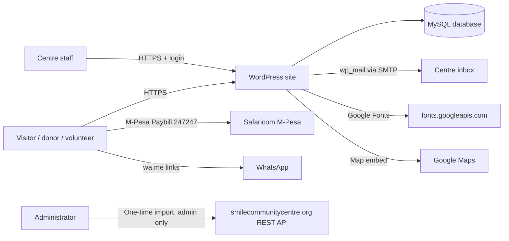
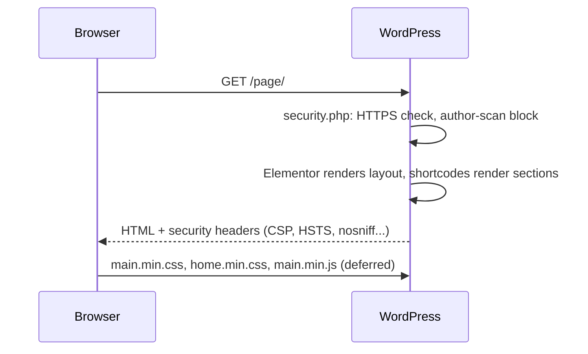
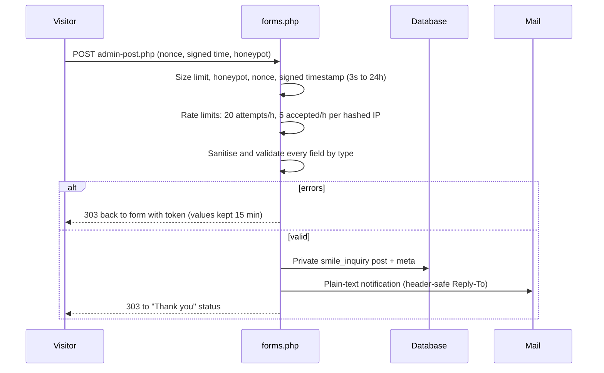
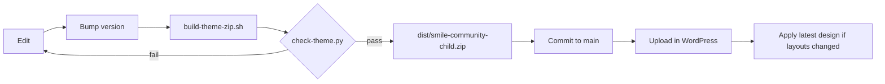

# Architecture

This document explains how the Smile Community Centre website is built, how a request moves through it, where data lives and how it is protected. For a one-page version see [ARCHITECTURE-ESSENTIALS.md](ARCHITECTURE-ESSENTIALS.md).

## 1. System context



Payments never pass through the website: donors pay by M-Pesa or bank and may tell the centre through the donation form.

## 2. Layers

| Layer | Component | Responsibility |
|---|---|---|
| Parent theme | Hello Elementor | Minimal base markup |
| Child theme | `smile-community-child` | Design system, templates, section shortcodes, setup wizard, security hardening |
| Site plugin | Smile Community Core | Data that must survive a theme change: centre details, forms and enquiries, redirects, photo privacy |
| Page builder | Elementor | Page layouts (imported from `demo/pages.json`) |
| Optional plugins | SEOPress, WP Super Cache, WP Mail SMTP | SEO, page cache, email delivery |

Rule: **presentation in the theme, data in the plugin.** If the theme is ever switched, enquiries, settings and redirects are kept.

## 3. Theme modules (`inc/`)

| File | Purpose |
|---|---|
| `security.php` | Security headers, HTTPS redirect, login throttling, generic login errors, session length, password minimum, user-enumeration blocks, XML-RPC off, REST CORS |
| `brand.php` | Bundled logo (1x/2x/3x, WebP + PNG), site icons, login logo, logo URL for schema |
| `seo.php` | Connected schema.org graph, title and description resolver (feeds SEOPress), indexing rules, fallback meta and Open Graph |
| `content-editor.php` | Smile Centre > Site text & photos: text overrides through `gettext`, photo overrides by key |
| `setup.php` | Theme supports, image sizes, asset loading (minified bundles), self-hosted fonts with preload, first-slide preload, Elementor trimming, speculative prerender |
| `template-tags.php` | Settings helper, phone links, breadcrumbs, reading time, stories per page |
| `components.php` | Icon set, story images, category labels, shared shortcodes |
| `home-sections.php` | Section shortcodes used across pages |
| `slider.php` | Hero slider and its data |
| `images.php` | Photo key to attachment lookups (cached) |
| `customizer.php` | Donate label, top bar, footer |
| `plugins.php` | Allow-listed plugin installer (admin, nonce, capability checked) |
| `importer.php` | One-click content import and "Apply latest design" |
| `wizard.php` | Smile Setup screens |

## 4. Plugin modules (`plugins/smile-community-core/includes/`)

| File | Purpose |
|---|---|
| `settings.php` | Centre details screen, typed sanitisation, `smile_core_get()` |
| `forms.php` | `[smile_form]` render and submit handler |
| `inquiries.php` | Private `smile_inquiry` post type, inbox columns, status and notes, retention |
| `shortcodes.php` | Giving, contact, map, directions, latest posts, settings shortcodes |
| `redirects.php` | 301 redirects for old URLs (404 only) |
| `media-privacy.php` | Strips EXIF/GPS metadata from uploaded photos |
| `dashboard.php` | Dashboard widget with enquiry counts |

## 5. Request flows

### 5.1 Page view



### 5.2 Enquiry form



### 5.3 Editing text and photos

```mermaid
sequenceDiagram
  participant E as Editor
  participant A as Site text & photos
  participant O as Options
  participant P as Public page
  E->>A: Change wording / choose photo (nonce, edit_pages)
  A->>O: smile_text_overrides / smile_image_overrides (sanitised)
  P->>O: gettext filter swaps edited text; smile_image_by_key() returns chosen photo
```

`scripts/extract-strings.py` lists every visitor-facing string into `demo/strings.json` at build time, so the screen always matches the code.

### 5.4 Content import (administrators only)

`wp_ajax_smile_demo_step` → nonce + `manage_options` → builds pages from `demo/pages.json`, sideloads photos with `download_url()` (SSRF-safe), imports stories from the live site with `wp_safe_remote_get()`, cleans HTML with `wp_kses_post()`.

## 6. Data model

| Data | Storage | Who can see it |
|---|---|---|
| Pages, stories, photos | Posts, attachments | Public |
| Centre details | Option `smile_core_settings` | Public where shown; edited by editors (form emails by admins only) |
| Enquiries | Private post type `smile_inquiry` + meta | Users with `smile_manage_inquiries` (administrators, editors) |
| Redirects | Option `smile_core_redirects` | Administrators |
| Rate-limit counters | Transients keyed by hashed IP | Nobody (raw IPs are never stored) |
| Design version | Option `smile_design_version` | Administrators |
| Text and photo changes | Options `smile_text_overrides`, `smile_image_overrides` | Editors and administrators |
| SEO sync marker | Option `smile_seo_synced` | Administrators |

Enquiries are excluded from search, REST, feeds and front-end queries, and are deleted by a daily retention job.

## 7. Front-end assets

- `assets/css/main.css` (all pages), `home.css` + `slider.css` (sections), `assets/js/main.js`, `slider.js` (home only)
- Built into `assets/build/*.min.*` by `scripts/build-theme-zip.sh`
- Fonts: Newsreader, Figtree and Caveat self-hosted in `assets/fonts/` (latin woff2), inline `@font-face`, two preloaded
- Brand: `assets/images/brand/` (logo sizes, icons)

## 8. Build and release



## 9. Security architecture

Defence in depth, summarised here and detailed in [SECURITY-AUDIT.md](SECURITY-AUDIT.md):

1. **Transport**: HTTPS redirect, HSTS, `upgrade-insecure-requests`.
2. **Browser**: CSP (`object-src`, `base-uri`, `frame-ancestors`, `form-action`), X-Frame-Options, nosniff, Referrer-Policy, Permissions-Policy, COOP.
3. **Input**: nonces, signed timestamps, honeypot, rate limits, typed sanitisation, allow-lists.
4. **Output**: context escaping everywhere, `wp_kses_post` for imported HTML.
5. **Access**: capability checks on every admin action; private enquiry post type.
6. **Identity**: login throttling, generic errors, short sessions, 12-character passwords, core password hashing.
7. **Exposure**: no version tag, no user enumeration, XML-RPC off, REST CORS limited to own origin.
