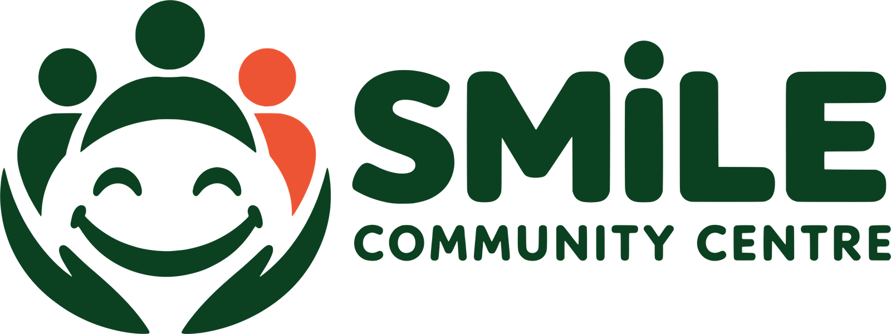
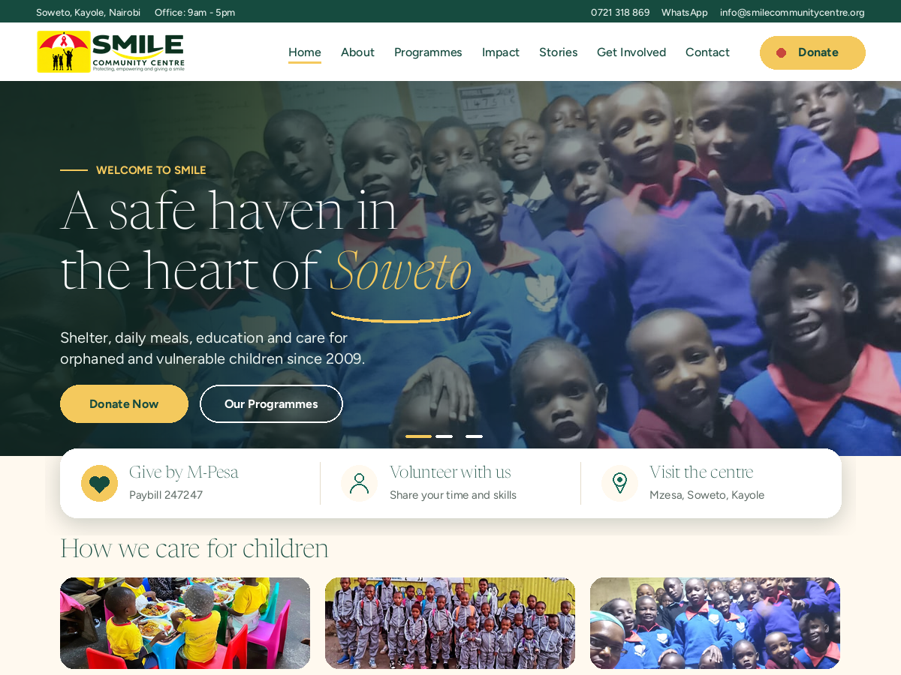
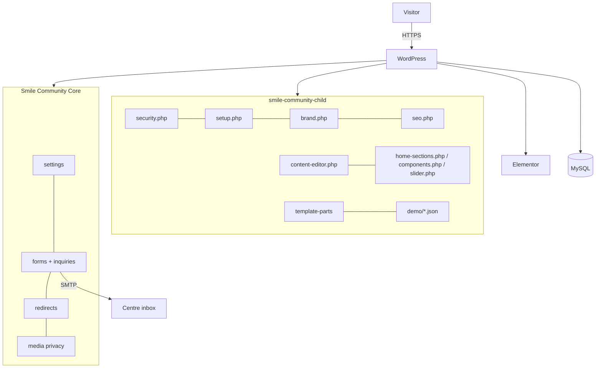

<div align="center">



# Smile Community Centre

### WordPress platform for [smilecommunitycentre.org](https://smilecommunitycentre.org/)

**A safe haven in the heart of Soweto, Kayole.** Smile Community Centre Children's Home gives orphaned and vulnerable children in Nairobi, Kenya, shelter, daily meals, education and care. This repository holds the whole website: a child theme, a bundled site plugin, every page layout, a one-click installer, and the documentation to run it.


-777BB4?logo=php&logoColor=white)


[Staging site](https://topnotchmall.co.ke/smilescommunity/) · [Staff guide](docs/admin-guide.md) · [Architecture](ARCHITECTURE.md) · [Product requirements](PRD.md) · [Security audit](SECURITY-AUDIT.md) · [SEO](docs/SEO.md) · [Changelog](CHANGELOG.md)

</div>

---



## Contents

- [At a glance](#at-a-glance)
- [What the site delivers](#what-the-site-delivers)
- [Editing the site](#editing-the-site)
- [Architecture](#architecture)
- [Security](#security)
- [SEO](#seo)
- [Performance](#performance)
- [Accessibility and safeguarding](#accessibility-and-safeguarding)
- [Project structure](#project-structure)
- [Requirements and installation](#requirements-and-installation)
- [Deploying an update](#deploying-an-update)
- [Configuration](#configuration)
- [Shortcodes](#shortcodes)
- [Quality gate](#quality-gate)
- [Documentation](#documentation)
- [Release history](#release-history)
- [Organisation](#organisation)

## At a glance

| | |
|---|---|
| **Organisation** | Smile Community Centre Children's Home, founded by Margret Nekesa Khaemba as a self-help group in 2009, registered as a Community Based Organisation in 2016 |
| **Location** | Mzesa, Soweto, Kayole (near Donholm Phase 8), Nairobi, Kenya |
| **Platform** | WordPress + Hello Elementor (parent) + `smile-community-child` (this theme) + Smile Community Core (bundled plugin) + Elementor |
| **Pages** | 21 designed pages, a Stories & News journal, search and a 404 page |
| **Giving** | M-Pesa Paybill 247247, Account 147516; bank transfer and in-kind gifts |
| **Editing** | Pages in Elementor; every other wording and photo in Smile Centre > Site text & photos; contact and payment details in Smile Centre > Centre details |
| **Install** | One zip, a three-step setup wizard, one-click content import |

## What the site delivers

### Pages

| Group | Pages |
|---|---|
| Who we are | Home · About Us · Our Founder · Our Goals · Our Impact · Gallery |
| What we do | Our Programmes · Education · Feeding · Child Care and Shelter · Health and Wellbeing · Sports and Talent |
| How to help | Get Involved · Donate · Volunteer · Partner With Us |
| Information | Stories & News · Contact Us · FAQ · Safeguarding and Child Protection · Privacy Policy |

### Signature features

- **Hero slider** with autoplay, pause, keyboard, swipe and reduced-motion support.
- **Gift calculator** that turns an amount into meals, water and school fees, with one-tap copy of the M-Pesa details.
- **Six secure enquiry forms** (contact, visit, volunteer, partner, donation, photo removal) feeding a private Enquiries inbox.
- **Stories & News journal**: lead story, "Also new", topic bar with a "More topics" menu, 12 stories per page, support card.
- **Wall of hope gallery** with filters and an accessible lightbox.
- **Get Involved journey**: one link bar across Get Involved, Donate, Volunteer and Partner.
- **Founder story**: journey timeline and a full-width quote.
- **Mobile-first navigation**: full-height menu drawer and a bottom tab bar.
- **New brand identity**: bundled logo in 1x, 2x and 3x sizes, site icons, login page logo.

## Editing the site

Nothing visitors see is locked in code.

| What | Where |
|---|---|
| Page layouts, headings, paragraphs, buttons, page photos | **Pages > Edit with Elementor** |
| Every other wording (589 texts: sections, cards, forms, footer, Stories page, messages) | **Smile Centre > Site text & photos > Text** (search, type, save; an empty box restores the original) |
| Photos used in sections (programme cards, gallery wall, founder, stories fallbacks) | **Smile Centre > Site text & photos > Photos** |
| Phone numbers, WhatsApp, email, address, hours, M-Pesa, bank, notification emails, volunteer notice | **Smile Centre > Centre details** |
| Home slider slides | **Appearance > Customize > Smile: Home slider** |
| Donate button, top bar, footer line | **Appearance > Customize > Smile: Header & Footer** |
| Menus | **Appearance > Menus** |
| Stories | **Posts** |
| SEO title and description of any page or story | SEOPress box under the editor (hand-typed values always win) |
| Old URL redirects | **Smile Centre > Redirects** (administrators) |

Step-by-step instructions for staff: [docs/admin-guide.md](docs/admin-guide.md).

## Architecture



**Rule: presentation in the theme, data in the plugin.** Enquiries, centre details and redirects survive a theme change. Full detail: [ARCHITECTURE.md](ARCHITECTURE.md) · one page: [ARCHITECTURE-ESSENTIALS.md](ARCHITECTURE-ESSENTIALS.md).

## Security

Reviewed line by line for production: [SECURITY-AUDIT.md](SECURITY-AUDIT.md).

| Control | How |
|---|---|
| Rate limiting | Forms: 5 accepted and 20 attempts an hour per connection. Sign-in: 5 failures per 15 minutes |
| Input sanitisation | Every field cleaned by type; drop-down answers checked against an allow-list; editor screens sanitised |
| Output escaping | `esc_html`, `esc_attr`, `esc_url`, `wp_kses_post` everywhere; no `innerHTML` with data |
| CSRF | Nonces on every form and admin action; signed timestamps on public forms |
| SQL injection | WordPress APIs only; the one direct query uses `$wpdb->prepare` |
| Passwords | WordPress salted hashing (bcrypt from 6.8); 12-character minimum |
| Sessions | 12 hours, or 7 days with "Remember me" |
| HTTPS | Redirect from http, HSTS, `upgrade-insecure-requests` |
| Headers | CSP (safe subset), X-Frame-Options, nosniff, Referrer-Policy, Permissions-Policy, COOP |
| CORS | REST API trusts only the site's own origin |
| Secrets | None in code; keys and SMTP passwords belong in `wp-config.php` or environment variables |
| Exposure | No version tag, no user enumeration, XML-RPC off |
| Access control | Capability checks on every admin action; private enquiry post type |

## SEO

Target searches: children's home in Nairobi / Kenya / Kayole, orphanage in Nairobi, donate to a children's home in Kenya, sponsor a child's education, volunteer at a children's home in Kenya. Details: [docs/SEO.md](docs/SEO.md).

- **One connected schema.org graph** on every page: NGO (founder, founding year, address, contact, logo, DonateAction), WebSite with site search, page type, breadcrumbs, and BlogPosting for stories. Facts only; no invented ratings or credentials.
- **Keyword-mapped titles and descriptions** for all 21 pages, patterns for every story and topic, kept in sync with SEOPress without overwriting hand edits.
- **Clean index**: search, tag, author and date pages are `noindex, follow`; attachment pages redirect.

## Performance

Target: first content in 1 to 3 seconds on mobile with page caching. Details: [docs/performance.md](docs/performance.md).

- Minified CSS and JS, deferred scripts, home-only slider script
- Self-hosted fonts (no Google Fonts requests), two preloaded
- First slide image preloaded; lazy images elsewhere; fixed logo size (no layout shift)
- Far-down sections painted only when needed (`content-visibility`)
- Elementor's icon font and Google Fonts skipped where unused
- Instant page changes (speculative prerender, WordPress 6.8+)
- Server side (host): WP Super Cache, browser caching and compression in `.htaccess`, PHP 8.2+

## Accessibility and safeguarding

- Keyboard navigation, visible focus, skip link, labelled forms, error summaries, 44 px tap targets, reduced-motion support, one H1 per page.
- No children's full names, schools or exact circumstances; photo GPS/camera data stripped on upload; a removal-request form routed to the safeguarding address.

## Project structure

```
.
├── README.md                       this file
├── CHANGELOG.md                    every release
├── ARCHITECTURE.md                 full architecture
├── ARCHITECTURE-ESSENTIALS.md      one-page architecture
├── PRD.md                          product requirements
├── SECURITY-AUDIT.md               security review, findings and fixes
├── docs/                           staff guide, install, QA, SEO, performance, workflow, audit, redirects
├── scripts/
│   ├── build-theme-zip.sh          minify, extract texts, quality gate, zip
│   ├── extract-strings.py          lists every editable text (demo/strings.json)
│   └── check-theme.py              quality and security gate
├── .github/workflows/build-theme.yml   runs the same gate on every push
└── wp-content/themes/smile-community-child/
    ├── style.css · functions.php · screenshot.png · searchform.php
    ├── inc/
    │   ├── security.php            headers, HTTPS, login limits, sessions, CORS
    │   ├── setup.php               theme setup, assets, fonts, speed
    │   ├── brand.php               logo, site icons, login logo
    │   ├── seo.php                 schema graph, titles, descriptions, indexing
    │   ├── content-editor.php      Site text & photos screen
    │   ├── template-tags.php       helpers (settings, links, breadcrumbs, reading time)
    │   ├── components.php          icons, story images, shared components
    │   ├── home-sections.php       section shortcodes used across pages
    │   ├── slider.php              home slider and photo lookups
    │   ├── images.php · customizer.php
    │   └── plugins.php · importer.php · wizard.php   Smile Setup (admins only)
    ├── template-parts/             header, footer, archive, single, search, 404, cards
    ├── assets/css · assets/js      source styles and scripts
    ├── assets/build/               minified bundles (generated)
    ├── assets/fonts/               self-hosted woff2 fonts
    ├── assets/images/brand/        logo and icons
    ├── demo/                       pages.json, images.json, menus.json, strings.json, seo-history.json
    └── plugins/smile-community-core/   bundled plugin (settings, forms, inquiries, shortcodes, redirects, media privacy)
```

## Requirements and installation

**Requirements:** WordPress 6.3+ (6.8+ for instant navigation), PHP 7.4+ (8.2 recommended), HTTPS certificate, a host that can install plugins directly.

1. **Upload the theme:** Appearance > Themes > Add New > Upload Theme, choose `smile-community-child.zip`, **Activate**. WordPress installs Hello Elementor automatically.
2. **Install plugins:** the **Smile Setup** wizard opens. Click **Install & activate** (Elementor and Smile Community Core required; SEOPress, WP Super Cache and WP Mail SMTP recommended).
3. **Import content:** click **Import content**. Pages, photos, menus, home page and brand settings are created.

Launch and rollback: [docs/install-and-deploy.md](docs/install-and-deploy.md).

## Deploying an update

1. `bash scripts/build-theme-zip.sh` (stops if the quality gate fails).
2. Upload the zip, choose **Replace active with uploaded**.
3. If page layouts changed (`demo/pages.json`), click **Apply latest design**.
4. If Smile Community Core is newer, Smile Setup > Plugins shows **Update available**: install it.
5. Elementor > Tools > **Regenerate CSS & Data**, clear the page cache, check the site.

Routine and checks: [docs/workflow.md](docs/workflow.md) · [docs/qa-checklist.md](docs/qa-checklist.md).

## Configuration

| Setting | Where |
|---|---|
| Centre details, payments, emails, retention | Smile Centre > Centre details |
| Wording and photos | Smile Centre > Site text & photos |
| Redirects | Smile Centre > Redirects |
| Slider, Donate button, top bar, footer | Appearance > Customize |
| SEO plugin | SEOPress (turn its Knowledge Graph off; the theme provides a richer one) |
| Secrets and hardening | `wp-config.php` (see [SECURITY-AUDIT.md](SECURITY-AUDIT.md#5-environment-and-secrets)) |
| Optional switches | Filters such as `smile_security_headers`, `smile_seo_schema`, `smile_use_brand_logo` (all default on) |

## Shortcodes

| Shortcode | Purpose |
|---|---|
| `[smile_form type="contact\|visit\|volunteer\|partner\|donation\|removal"]` | Secure enquiry forms |
| `[smile_mpesa]` · `[smile_bank]` · `[smile_online_giving]` · `[smile_giving_tiers]` · `[smile_gift_calc]` · `[smile_use]` · `[smile_trust]` | Giving |
| `[smile_contact]` · `[smile_contact_hub]` · `[smile_next_steps]` · `[smile_visit_expect]` · `[smile_directions]` · `[smile_map]` | Contact and visits |
| `[smile_hero_slider]` · `[smile_programmes]` · `[smile_needs]` · `[smile_priorities]` · `[smile_journey]` · `[smile_community]` · `[smile_stories]` · `[smile_latest_posts]` | Home sections |
| `[smile_glance p=""]` · `[smile_pull p=""]` · `[smile_help_ways p=""]` | Programme pages |
| `[smile_wall]` · `[smile_stats]` | Gallery and impact |
| `[smile_mv]` · `[smile_objectives]` · `[smile_dream]` · `[smile_founder_words]` · `[smile_founder_path]` | About, Goals, Founder |
| `[smile_involve]` · `[smile_involve_nav]` · `[smile_roles]` · `[smile_lookfor]` · `[smile_intl]` · `[smile_partner_types]` · `[smile_volunteer_notice]` | Get involved |
| `[smile_commitments]` · `[smile_urgent]` · `[smile_concern_contacts]` · `[smile_steps set=""]` | Safeguarding |
| `[smile_setting key=""]` | Any centre detail |

## Quality gate

`scripts/check-theme.py` runs on every build and in GitHub Actions; the zip is not made if anything fails:

- PHP syntax (`php -l`), JavaScript syntax (`node --check`), CSS parse errors (`tinycss2`)
- Page layouts: every shortcode exists, every photo exists, internal links resolve, unique element IDs, one H1 per banner
- Security patterns: `eval`, `base64_decode`, `unserialize` of input, unescaped request output, unprepared SQL, `wp_remote_get`, `innerHTML` from data, stray backslash before `!`

## Documentation

| Document | Audience |
|---|---|
| [docs/admin-guide.md](docs/admin-guide.md) | Centre staff: editing text, photos, pages, stories, enquiries |
| [docs/install-and-deploy.md](docs/install-and-deploy.md) | Installing, launching, rolling back |
| [docs/workflow.md](docs/workflow.md) | Developers: release routine |
| [docs/qa-checklist.md](docs/qa-checklist.md) | Pre-launch and post-release checks |
| [docs/SEO.md](docs/SEO.md) | Keyword map, schema, Search Console |
| [docs/performance.md](docs/performance.md) | Speed decisions and server steps |
| [ARCHITECTURE.md](ARCHITECTURE.md) · [ARCHITECTURE-ESSENTIALS.md](ARCHITECTURE-ESSENTIALS.md) | How it is built |
| [PRD.md](PRD.md) | Goals, users, requirements |
| [SECURITY-AUDIT.md](SECURITY-AUDIT.md) | Findings, fixes, hardening |
| [docs/known-limitations.md](docs/known-limitations.md) | Open decisions for the centre |
| [docs/audit.md](docs/audit.md) · [docs/migration-manifest.md](docs/migration-manifest.md) · [docs/redirects.md](docs/redirects.md) | Old-site audit and migration |

## Release history

Highlights below; every change is in [CHANGELOG.md](CHANGELOG.md).

| Version | Highlights |
|---|---|
| 2.18.0 | The Smile curve from the logo used as the site's signature mark |
| 2.17.0 | Every text and photo editable; self-hosted fonts; instant navigation |
| 2.16.0 | New logo and site icons |
| 2.15.x | SEO: schema graph, titles and descriptions for every page, story and topic |
| 2.14.x | Security hardening and audit; compact gift calculator |
| 2.10 to 2.13 | Stories & News redesign, Founder and Volunteer improvements |
| 2.4 to 2.9 | Gallery, Impact, Get Involved, Contact, About, Goals; quality gate |
| 1.7 to 2.3 | Speed, inner pages, programmes, mobile navigation |

## Organisation

**Smile Community Centre Children's Home**
Mzesa, Soweto, Kayole (near Donholm Phase 8), Nairobi, Kenya · P.O. Box 156-00518, Nairobi
0721 318 869 (also WhatsApp) · info@smilecommunitycentre.org · [Instagram](https://www.instagram.com/smile_kenya_/)

**Donate:** M-Pesa Paybill **247247**, Account **147516**

## License

GPL-2.0-or-later, the same as WordPress. Photos and the logo belong to Smile Community Centre and are not covered by the code licence.
